# MNIST MLP Hyperparameter Study — Core Grid (6,300 Runs)

> **Scope:** This report covers only the **Core** suite. Network-shape patterns, optimizer comparisons, regularization, initialization and scheduler suites are deliberately excluded.

A full-factorial study of how **network depth, hidden-layer width, mini-batch size and learning rate** interact to affect numerical stability, effective learning, validation performance, train–validation generalization gaps and compute efficiency.

**Important:** All results below are from **one random seed (1234)**, **20 epochs**, and the same **5,000-image validation split**. **No independent test-set accuracy is claimed.** The charts summarize this specific grid, not universal causal effects.

## Highlights

| Outcome | Core results |
|---|---:|
| Configurations | **6,300** |
| Completed 20 epochs | **5,169 (82.05%)** |
| Non-finite-loss failures | **1,131 (17.95%)** |
| Reached ≥90% validation accuracy at least once | **3,293 (52.27% of all configurations)** |
| Reached ≥97% *final-epoch* validation accuracy | **1,038 (16.48%)** |
| Highest observed final validation accuracy | **98.58%** |
| Mean final train–validation accuracy gap (train accuracy ≥95%) | **2.03 percentage points** |
| Late overfitting-like loss signal | **155 / 3,237** final effective learners |
| Validation loss still clearly improving late | **1,844 / 3,293** effective learners |
| Late accuracy collapse (≥10 pp below own best) | **35** configurations |

## 1. Experiment design

The Core grid is the **Cartesian product** of four parameters:

| Hyperparameter | Values | Count |
|---|---|---:|
| Hidden-layer depth | 1, 2, 3, 5, 8, 10, 15, 20, 25 | 9 |
| Hidden-layer width | 5, 10, 20, 40, 64, 100, 128, 256, 512, 1024 | 10 |
| Batch size | 16, 32, 64, 128, 256, 512, 1024 | 7 |
| Learning rate | 0.001, 0.003, 0.01, 0.03, 0.05, 0.1, 0.2, 0.5, 1.0, 10.0 | 10 |

**9 × 10 × 7 × 10 = 6,300** distinct configurations, each run once.

Fixed settings: **MNIST** (55,000 training / 5,000 validation), flattened 784-dimensional inputs, **fully connected MLP with constant hidden-layer width**, ReLU activation, He initialization, cross-entropy loss, plain SGD (momentum 0), constant learning rate, no dropout, no weight decay, 20 epochs, seed 1234.

Example: depth 3 and width 128 means **784 → 128 → 128 → 128 → 10**. Other architecture *patterns* are not varied in this Core grid.

### Definitions and denominators

- **Numerical divergence:** the runner records a failed configuration when evaluation loss becomes non-finite (NaN or Inf). This is an operational failure criterion, not proof of a specific gradient-explosion mechanism.
- **Effective learning:** a completed configuration reaches **≥90% best validation accuracy** at least once. This threshold does **not** prove mathematical convergence.
- **Final high accuracy:** the **epoch-20 validation accuracy** is ≥97%. Failed configurations count as **not** meeting this target.
- **Generalization gap:** `100 × (final_train_acc − final_val_acc)`, measured in **percentage points (pp)**. This is **train vs validation**, not train vs test.

## 2. Overall outcomes

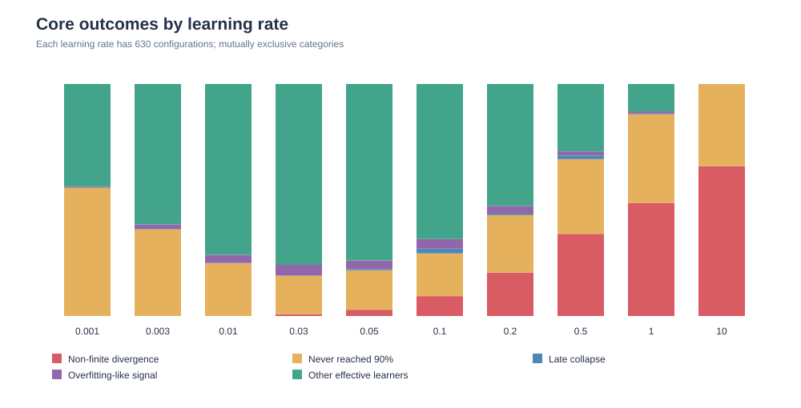

*Figure 1. Every learning rate represents 630 configurations. The five categories are mutually exclusive; numerical stability is not the same as successful learning.*

| Outcome | Runs |
|---|---:|
| Non-finite numerical divergence | 1,131 |
| Completed but never reached 90% validation accuracy | 1,876 |
| Completed and reached 90% at least once | 3,293 |

Within the completed models, **695** had best validation accuracy ≤12%, close to the 10-class chance baseline. Notably, **all 630 width-5 configurations remained numerically finite**, but none reached 90% validation accuracy.

## 3. Numerical stability: which hyperparameters matter?

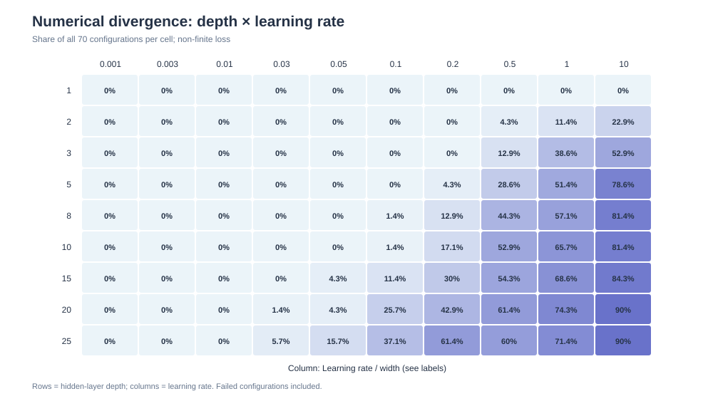

*Figure 2. Percentage of non-finite failures for each depth × learning-rate combination; **70 runs per cell**, including failures.*

At depth 1 and LR 10, **0/70** diverged, yet the models largely failed to learn; at depth 25 and LR 10, **63/70 (90%)** diverged. The learning-rate range associated with stable training depends strongly on depth.

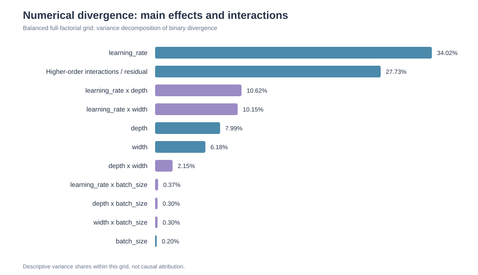

*Figure 3. Descriptive variance decomposition across the balanced four-factor grid; **not causal attribution**.*

| Factor / interaction | Share of observed variation |
|---|---:|
| Learning rate (main effect) | **34.02%** |
| Learning rate × depth | **10.62%** |
| Learning rate × width | **10.15%** |
| Depth (main effect) | **7.99%** |
| Width (main effect) | **6.18%** |
| Batch size (main effect) | **0.20%** |

The remaining variation includes other pairwise and higher-order interactions. A learning rate cannot be described as safe independently of architecture.

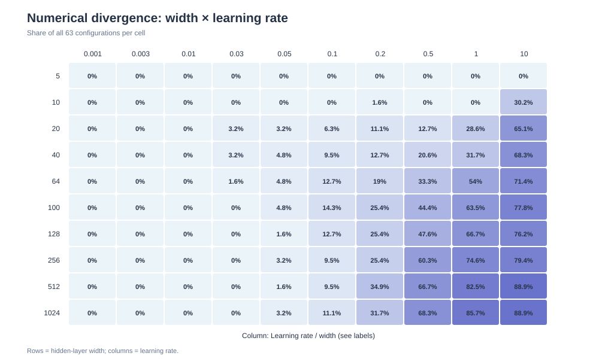

*Figure 4. Width × learning-rate divergence rate; **63 runs per cell**.*

**Possible mechanisms:** excessively large SGD updates, unstable activation/weight magnitudes or gradients. The experiment did not log gradient norms or activation distributions, so these explanations remain hypotheses.

## 4. Effective learning and convergence behavior

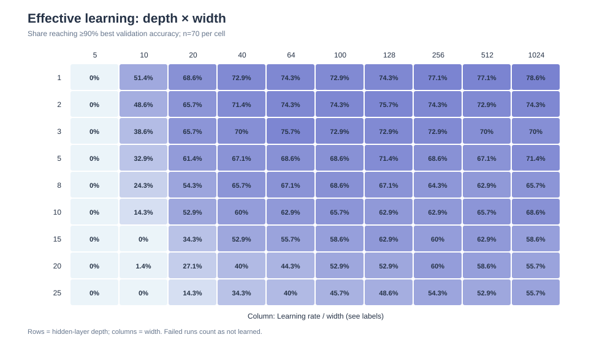

*Figure 5. Percentage of all configurations reaching ≥90% best validation accuracy; **70 runs per cell**.*

Very narrow networks often remain stable without learning enough. Wider networks reach useful accuracy more often, but may still diverge under aggressive learning rates.

### Is 20 epochs sufficient?

For models that reached ≥90% validation accuracy, compare average validation loss in epochs **11–15** with epochs **16–20**. Mark a run as **still improving late** if the second window is at least **0.005** and **5%** lower.

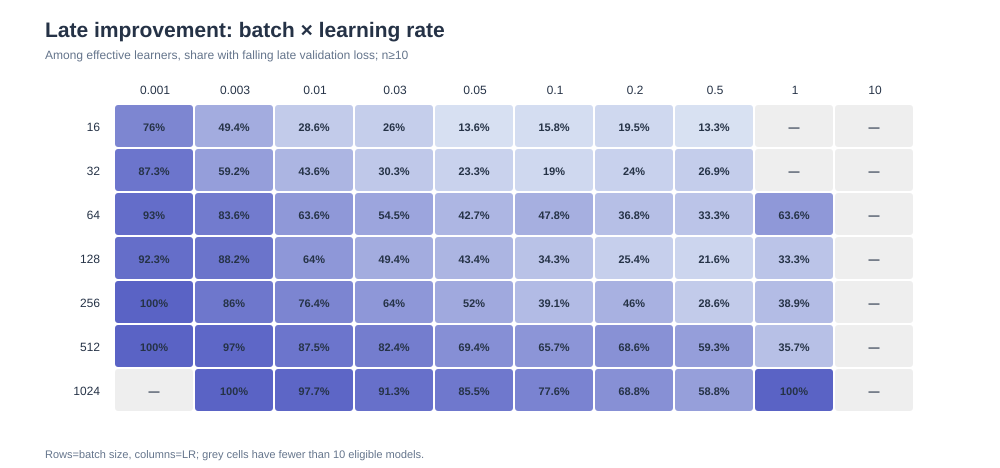

*Figure 6. Percentage of eligible effective learners with clearly falling late validation loss. Grey means fewer than 10 eligible models; denominators vary.*

**1,844 / 3,293 (56.0%)** effective learners met this criterion. Among effective learners with LR 0.001, **87.9%** still improved late; for batch size 1024, **83.2%** did.

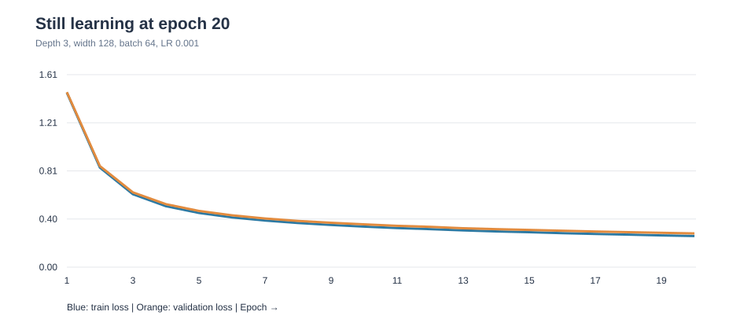

*Figure 7. Real run: depth 3, width 128, batch 64, LR 0.001. Training and validation loss are still falling at epoch 20.*

**Confounder:** at 55,000 training images and 20 epochs, batch 16 gives approximately **68,760 optimizer updates**, while batch 1024 gives approximately **1,080**. Fixed epochs are **not** a controlled comparison at fixed optimizer steps.

## 5. Final validation performance

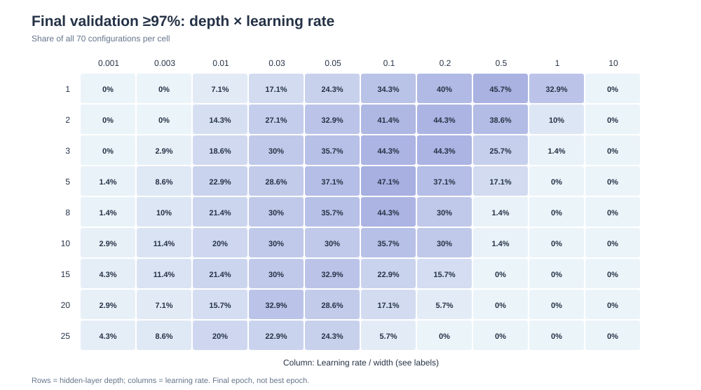

*Figure 8. Percentage reaching ≥97% **at epoch 20**, including failed configurations in the denominator; **70 runs per cell**.*

For depth 5 and LR 0.1, **33/70 (47.1%)** finished ≥97%; for depth 25 and LR 0.2, **0/70** did. Higher depth shifts the favorable learning-rate range downward in this grid.

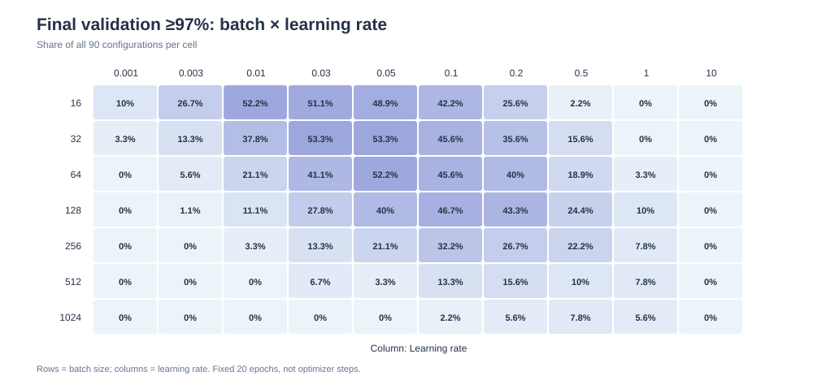

*Figure 9. Percentage reaching ≥97% at epoch 20; **90 runs per cell**.*

At batch 32 with LR 0.03 or 0.05, **48/90 (53.3%)** reached ≥97%; at batch 1024 with LR 0.03, **0/90** did. Differences in update count must be considered before attributing this to batch size itself.

**Best epoch vs final epoch:** **1,175** configurations reached ≥97% at least once, but only **1,038** still achieved ≥97% at epoch 20. Best-checkpoint and final-checkpoint evaluations are not interchangeable.

## 6. Generalization gap and overfitting-like behavior

Across all **5,169** completed configurations, the mean final train–validation accuracy gap was **1.26 pp**, but this includes models that never learned. Among the **2,575** completed models with training accuracy ≥95%, mean training accuracy was **98.46%**, mean validation accuracy **96.43%**, and mean gap **2.03 pp**.

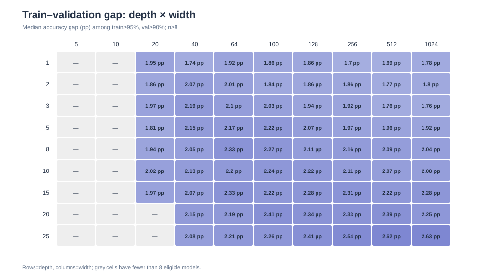

*Figure 10. Median final train–validation gap (pp), conditional on train accuracy ≥95% and validation accuracy ≥90%. Grey cells have fewer than 8 eligible runs; this conditioning introduces selection effects.*

At width 1024, the median gap was **1.78 pp** for depth 1 and **2.63 pp** for depth 25. This is an **association**, not proof that depth itself causes overfitting.

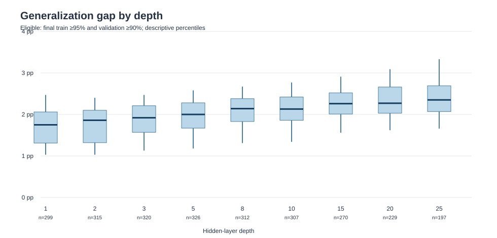

*Figure 11. Gap distributions among successful learners; box = 25th–75th percentile, line = median, whiskers = 5th–95th percentile.*

### Overfitting-like loss signature

A final accuracy gap alone is insufficient to diagnose overfitting. Here, a *late overfitting-like signal* means that between epochs **11–15** and **16–20**:

1. Mean **training loss falls** by at least **0.005 and 5%**.
2. Mean **validation loss rises** by at least **0.005 and 5%**.
3. The final validation accuracy is at least **90%**.

**155 / 3,237 (4.79%)** final effective learners met this conservative, threshold-dependent criterion.

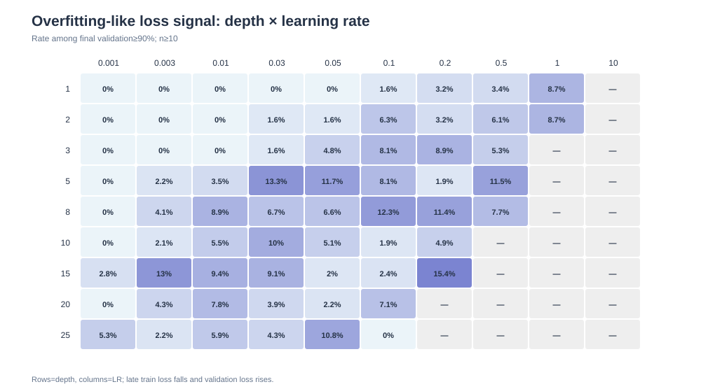

*Figure 12. Conditional rate among final validation ≥90% models; cells with fewer than 10 eligible runs are masked.*

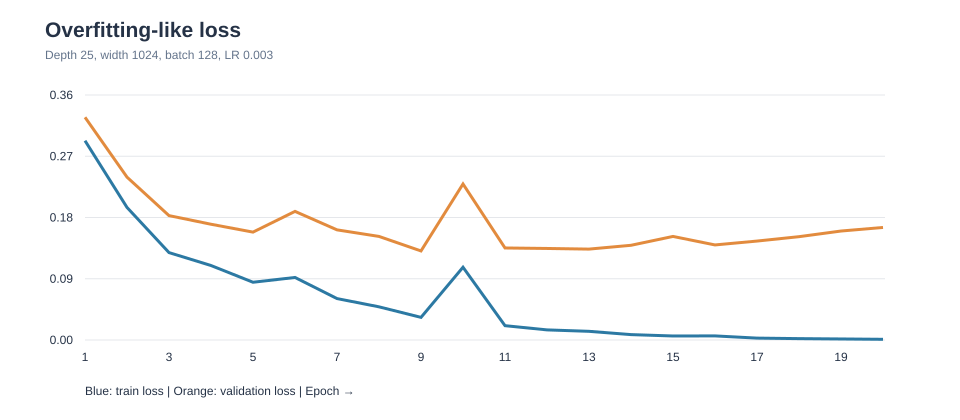

*Figure 13. Real run: depth 25, width 1024, batch 128, LR 0.003. Validation loss reached ≈0.1308 at epoch 9 and rose to ≈0.1653 by epoch 20 while training loss continued decreasing.*

This is evidence of **overfitting-like training dynamics**, not a claim that every model without this signal is free of overfitting. No independent test-set results are reported.

## 7. Late training collapse: distinct from overfitting

**35** configurations reached ≥90% validation accuracy but finished at least **10 pp** below their own best validation accuracy.

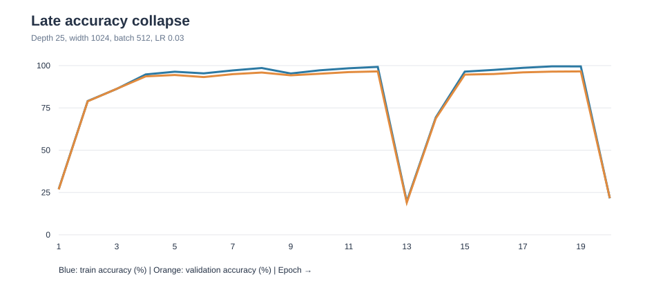

*Figure 14. Real run: depth 25, width 1024, batch 512, LR 0.03. Best validation ≈96.56%; final ≈21.66%. Training accuracy also fell to ≈21.53%.*

Because **training and validation performance deteriorated together**, this is more consistent with optimization instability than classic overfitting. **Finite losses do not guarantee stable learning.**

## 8. Accuracy–compute trade-off

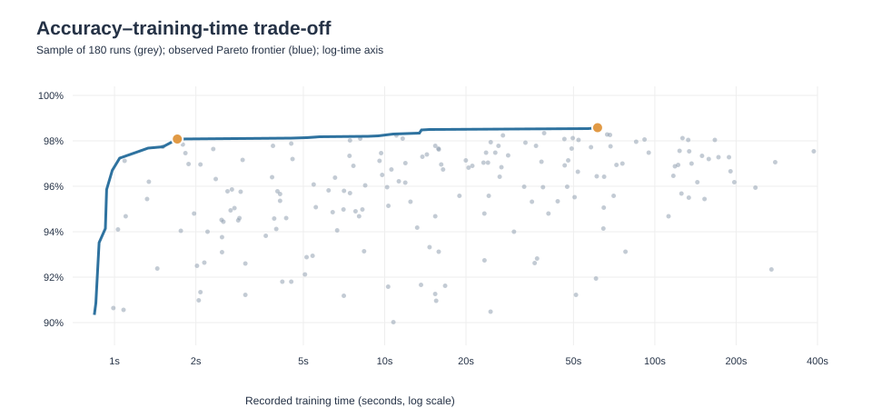

*Figure 15. Illustrative 180-run sample plus the observed full-data Pareto frontier. Horizontal axis is recorded training seconds on a logarithmic scale. Times are hardware-dependent.*

| | Highest final validation | Fastest observed final ≥98% |
|---|---:|---:|
| Validation accuracy | **98.58%** | **98.08%** |
| Depth / width | 2 / 1024 | 1 / 512 |
| Batch / LR | 16 / 0.2 | 512 / 1.0 |
| Parameters | 1,863,690 | 407,050 |
| Recorded training time | 61.39 s | 1.71 s |

The faster candidate used about **78% fewer parameters** and recorded roughly **36× less training time**, for a **0.50 pp** lower validation accuracy. These are **selected single-run observations**, not repeatability or deployment benchmarks.

## 9. Limitations and next experiments

- **No independent test evaluation:** all reported performance is validation performance; repeated selection from 6,300 runs may favor validation-set-specific winners.
- **One seed:** no confidence intervals over independent training runs.
- **20 epochs, not fixed update count:** especially important for batch-size conclusions.
- **One dataset, plain SGD, constant-width MLPs:** no claim of transfer to CNNs, other datasets or optimizers.
- **Conditional gap/overfitting analyses:** restricting to successful learners can introduce selection bias.
- **No direct mechanism instrumentation:** gradient/weight/activation norms were not recorded.
- **Operational thresholds:** ≥90%, ≥97%, and 5% + 0.005 late-loss criteria are analysis choices.

**Next:** repeat selected configurations across 3–5 seeds; extend undertrained configurations to 50–100 epochs; compare fixed optimizer-step budgets; log gradient norms to investigate divergence; compare parameter-matched depths; evaluate selected finalists once on the untouched MNIST test set.

## 10. Data provenance and reproduction

This report was computed from the completed experiment's `summary.csv` and `epoch_history.csv`, filtered to `suite == "core"`. These **large raw result files are not committed here**. The committed [`metrics/figure_data.json`](metrics/figure_data.json) contains aggregated chart values and three selected real training traces so the report remains reviewable without including the full 7,644-run outputs.

Expected local files:

```text
01-neural-network-foundations/
  outputs/hyperparameters/comprehensive/full_2026/
    summary.csv
    epoch_history.csv
```

The experiment runner `experiments/hyperparameters/full_sweep.py` was used locally for the recorded study, but **was not present on the repository's main branch when this documentation was prepared**. The report therefore does **not** claim the training run can currently be reproduced from the published repository alone. Before publishing a training reproduction command, the actual runner and its tests should be reviewed and committed separately.

The SVG figures in [`figures/`](figures/) are committed and render directly in GitHub Markdown. They are based on the provided CSV results and aggregate data. The aggregate JSON is a compact audit trail, **not a substitute for the original per-run CSVs or a full figure-generation pipeline**.

---

*This document intentionally covers **Core only**. The five other experiment suites will be analyzed separately.*
